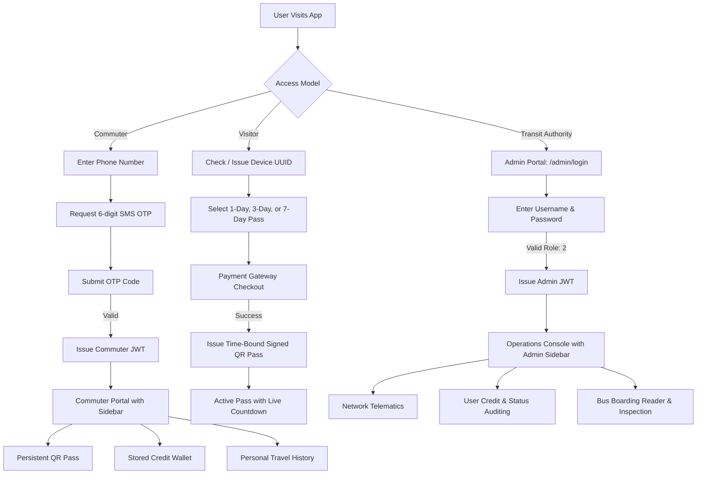

# Metropolitan Transport Ticketing System – Architectural Blueprint & Design Decisions

This document acts as the definitive single source of truth for the **UrbanTransit** Metropolitan Transport Ticketing System. It documents system-wide architectural invariants, domain rules, security models, user flow topologies, and cryptographic verification standards.

---

## 1. Executive Summary & Domain Scope

UrbanTransit is a modern, privacy-preserving contactless public transport ticketing and turnstile gate management platform. The system is engineered to handle metropolitan rail, tram, and rapid bus transit networks through three strictly separated operational domains:

1. **Local Commuter Domain (Account-Based):**
   - Designed for frequent, resident transit passengers.
   - Requires minimal personal data: only **Full Name** and **Verified Phone Number** (no passwords, addresses, national IDs, or birth dates).
   - Authenticated via passwordless 6-digit SMS OTP.
   - Holds a stored-value digital credit wallet with multi-tier top-ups (+500, +1000, +2500, +5000 Credits) and volume bonuses.
   - Issues a permanent, reusable HMAC-SHA256 signed QR credential (`TK1|LOCAL|...`).
   - Deducts standard transit fares (standard 150.00 Credits) atomically upon turnstile tap-out.

2. **Visitor & Tourist Domain (Pass-Based):**
   - Designed for short-term visitors, international tourists, and occasional passengers.
   - Zero-friction, zero-account model: no profile, no phone number, and no personal data collected.
   - Identified solely by an anonymous RFC4122 Device UUID stored in client local storage.
   - Offers pre-paid time-bound unlimited travel passes:
     - **1-Day Pass (24 Hours)** – 350.00 Credits / $5.00
     - **3-Day Pass (72 Hours)** – 900.00 Credits / $12.50
     - **7-Day Pass (168 Hours / 1 Week)** – 1800.00 Credits / $25.00
   - Generates a cryptographically signed guest pass QR (`TK1|GUEST|...`) with embedded UNIX expiration epoch.
   - Provides an active pass view featuring real-time countdown clocks and device screenshot recommendations.

3. **Transit Authority Operations Console (`/admin`):**
   - Dedicated management suite for transit supervisors, station agents, and revenue inspectors.
   - Role-authorized JWT access control (`UserRole.Admin` = 2, `UserRole.Inspector` = 1).
   - Real-time network telematics: circulating commuter credit float, active guest pass fleet, total tap journeys, and system revenue.
   - Passenger account auditing: balance adjustments with audit reason logging, and account freeze/unfreeze controls.
   - Dedicated Bus Boarding Reader (`/admin/reader`) for Tap In / Tap Out validation and Ticket Inspection (`/admin/inspection`) console.

---

## 2. Core Architectural Principles & Invariants

### 2.1 Minimal Data Footprint (Privacy by Design)
Transit authorities should only collect data strictly necessary to provide travel clearance:
- **Commuters:** Stored entity holds only `FullName`, `PhoneNumber`, `CreditBalance`, `PersistentQrToken`, and `IsActive`. Passwords, addresses, social security numbers, and demographic data are intentionally excluded.
- **Visitors:** Absolutely zero PII is collected or persisted. The visitor record contains only an anonymous `DeviceUuid` and the expiration timestamp of their purchased pass tier.

### 2.2 Physical Hardware Scanning Separation Policy
In public transit networks, turnstile gate scanners and optical readers are physical station infrastructure (or handheld ticket inspector devices). They are **not** commuter-facing or visitor-facing features:
- **Passenger Web Client:** Strictly displays QR credentials, handles wallet top-ups, and facilitates pass checkouts. No camera scanners, turnstile simulation widgets, or gate testing tools exist anywhere in passenger views (Landing, Commuter Hub, or Visitor Pass screens).
- **Admin Operations Console:** Hosts the **Bus Boarding Reader** (`/admin/reader`) and **Ticket Inspection** (`/admin/inspection`) tools allowing transit operators to execute authentic Tap In / Tap Out journeys and cryptographic verification.

### 2.3 Cryptographic Token Security
All QR passes displayed on mobile devices or printed passes carry tamper-evident signatures:
- **Algorithm:** HMAC-SHA256 with server-side salt and constant-time string comparison (`CryptographicOperations.FixedTimeEquals`) to prevent timing side-channel attacks.
- **Payload Format:**
  ```text
  TK1|{type}|{identifier}|{expiryEpoch}|{nonce}|{signature}
  ```
  - `TK1`: Protocol specification version 1.
  - `type`: `LOCAL` (account-bound) or `GUEST` (device-bound).
  - `identifier`: User GUID (for commuters) or RFC4122 Device UUID (for visitors).
  - `expiryEpoch`: Unix timestamp in seconds (0 for permanent commuter tokens; future timestamp for guest passes).
  - `nonce`: Cryptographically randomized 8-character hex nonce preventing replay attacks.
  - `signature`: URL-safe Base64 HMAC-SHA256 hash computed over `TK1:{type}:{identifier}:{expiryEpoch}:{nonce}`.

---

## 3. Monorepo Structure

```text
Ticketing-System/
├── Ticketing-System-Backend/          # ASP.NET Core 10 Web API
│   ├── Controllers/                  # REST API Controllers
│   │   ├── AccountController.cs      # Commuter profile, wallet top-up & trip ledger
│   │   ├── AdminController.cs        # Authorized operations, telematics & audits
│   │   ├── AuthController.cs         # Phone SMS OTP dispatch & Admin JWT credentials
│   │   └── TokenController.cs        # QR issuance, guest pass checkout & gate validation
│   ├── Services/                     # Domain services & business rules
│   │   ├── Fare/                     # IFareStrategy implementations
│   │   │   ├── IFareStrategy.cs      # Dynamic fare contract
│   │   │   ├── DistanceBasedFareStrategy.cs # Standard distance-tier fare calculation
│   │   │   └── FlatRateFareStrategy.cs      # Zero-fare pass validation
│   │   ├── AccountService.cs         # Wallet ledger adjustments & transaction history
│   │   ├── AuthService.cs            # OTP verification & JWT token generation
│   │   └── TokenService.cs           # HMAC-SHA256 cryptographic signing & validation
│   ├── Repositories/                 # Entity Framework Core data repositories
│   ├── Models/
│   │   ├── Entities/                 # PostgreSQL mapped tables (User, TransportToken, Journey)
│   │   ├── Dtos/                     # Strongly-typed API request/response contracts
│   │   └── Enums/                    # TokenType, JourneyStatus, UserRole
│   ├── Data/
│   │   ├── AppDbContext.cs           # EF Core database context & index configurations
│   │   └── DbInitializer.cs          # Database migrations & admin seed accounts
│   ├── Extensions/                   # Service registration & JWT middleware configuration
│   └── Program.cs                    # Application pipeline bootstrap
│
├── Ticketing-System-Frontend/         # React 19 + TypeScript + Vite + Tailwind CSS
│   ├── src/
│   │   ├── api/                      # Axios API clients with bearer token interceptors
│   │   ├── components/               # Reusable atomic UI & layout elements
│   │   │   ├── CommuterSidebar.tsx   # Dedicated commuter navigation with min-h-0 flex scroll
│   │   │   ├── AdminSidebar.tsx      # High-density operations console navigation
│   │   │   ├── Navbar.tsx            # Clean visitor & public landing header
│   │   │   ├── QRViewer.tsx          # High-contrast SVG QR with PNG download
│   │   │   └── QrScanInput.tsx       # Handheld scanner camera & optical input
│   │   ├── layouts/
│   │   │   ├── MainLayout.tsx        # Responsive layout wrapping Commuter & Visitor views
│   │   │   └── AdminLayout.tsx       # Isolated enterprise operations console layout
│   │   ├── pages/
│   │   │   ├── Home.tsx              # Clean landing portal (Commuter vs Visitor entry)
│   │   │   ├── Login.tsx             # Phone SMS OTP commuter login
│   │   │   ├── Register.tsx          # Minimal commuter registration
│   │   │   ├── Dashboard.tsx         # Commuter transit hub (quick balance, pass status, shortcuts)
│   │   │   ├── LocalQrPage.tsx       # Dedicated persistent QR pass view
│   │   │   ├── TopUpCreditsPage.tsx  # Digital wallet top-up & payment tier selection
│   │   │   ├── ProfilePage.tsx       # Commuter profile & filterable journey ledger
│   │   │   ├── GuestPeriodPage.tsx   # Visitor duration selection (1, 3, 7 days)
│   │   │   ├── CheckoutPage.tsx      # Pass order review & network inclusions
│   │   │   ├── PaymentPage.tsx       # Mock payment gateway (Cards, Apple Pay, Google Pay)
│   │   │   ├── GuestQrPage.tsx       # Active visitor pass with live countdown clock
│   │   │   ├── AdminLogin.tsx        # Dedicated administrator authentication view
│   │   │   ├── AdminDashboard.tsx    # Live operations control center & user auditing
│   │   │   ├── BoardingReaderPage.tsx# Dedicated Bus Boarding Reader (Tap In / Tap Out)
│   │   │   ├── TicketInspectionPage.tsx # Field ticket inspection console
│   │   │   └── ReportsPage.tsx       # Operational & revenue reporting
│   │   ├── routes.ts                 # Centralized type-safe route definitions
│   │   ├── types.ts                  # Shared TypeScript contracts & domain DTOs
│   │   └── App.tsx                   # Master router tree, auth guards & layout bindings
│   └── package.json
│
├── docker-compose.yml                # PostgreSQL container specification
├── package.json                      # Monorepo task orchestration scripts
├── Ticketing-System.sln              # Visual Studio solution file
└── GEMINI.md                         # This authoritative document
```

---

## 4. Authentication, Authorization & Identity Flow



---

## 5. Stored Credit & Fare Deduction Rules

### 5.1 Fare Calculation Strategy Pattern
The backend enforces a strict Strategy design pattern via `IFareStrategy`:
- **Distance-Based Strategy (`DistanceBasedFareStrategy.cs`):**
  - Standard metro ride fare: `150.00 Credits` (~$2.50 USD).
  - Zone adjustments: Inter-zone hops add `50.00 Credits` per transit zone boundary crossed.
  - Commuter taps are rejected at turnstiles if `CreditBalance < 150.00`.
- **Flat-Rate / Pass-Based Strategy (`FlatRateFareStrategy.cs`):**
  - Guest passes carry zero incremental fare deduction during their validity period (`StartsAtUtc <= Now <= ExpiresAtUtc`).
  - Turnstile tap verifies the cryptographic signature and checks that `ExpiresAtUtc > Now`.

### 5.2 Commuter Digital Wallet Reload Tiers
The commuter digital wallet provides volume reload incentives:
- **+500 Credits ($5.00)** – Standard reload (approx. 3 standard rides).
- **+1000 Credits ($10.00)** – Popular tier (+50 bonus credits = 1,050 total).
- **+2500 Credits ($25.00)** – commuter value tier (+200 bonus credits = 2,700 total).
- **+5000 Credits ($50.00)** – Monthly commuter package (+500 bonus credits = 5,500 total).

---

## 6. Layout Topologies & User Navigation Separation

To maintain professional, industry-standard UX, user interfaces are strictly differentiated:

| Attribute | Commuter Portal | Visitor Pass Wizard | Admin Operations Console |
| :--- | :--- | :--- | :--- |
| **Route Prefix** | `/dashboard`, `/qr`, `/top-up`, `/profile` | `/guest-period`, `/checkout`, `/payment`, `/guest-qr` | `/admin/*` |
| **Layout Template** | `MainLayout` with `CommuterSidebar` | `MainLayout` with top `Navbar` (no sidebar) | `AdminLayout` with `AdminSidebar` |
| **Sidebar Behavior** | Desktop 64-column fixed sidebar, mobile slide drawer, `min-h-0` flex scroll | **No Sidebar** (clean full-width checkout wizard) | High-contrast dark operations sidebar with telematics badges |
| **Token Storage** | `token` + `user` in `localStorage` | `device_uuid` + `guest_pass` in `localStorage` | `admin_token` + `admin_user` in `localStorage` |
| **Primary Interaction** | Digital wallet, persistent pass, trip ledger | Linear checkout & active pass countdown | Live network metrics, user account audits, boarding reader taps & ticket inspection |

---

## 7. Testing & Operational Verification

### Default Development Credentials
- **Admin Portal:** `http://localhost:5173/admin/login`
  - Username: `admin`
  - Password: `Admin@123`
  - Role: `Admin` (2)
- **Commuter Registration / Login:** `http://localhost:5173/login`
  - Country Codes: LK (`+94`), US (`+1`), UK (`+44`), AU (`+61`), SG (`+65`), IN (`+91`), AE (`+971`).
  - SMS OTP: Mock OTP code is displayed directly in the user notification toast in development mode.

### Continuous Verification Commands
- **Type Checking & Linting:** `npm run build:frontend` (executes `tsc -b && vite build`)
- **Backend Compilation:** `npm run build:backend` (executes `dotnet build Ticketing-System.sln`)
- **Container Health:** `npm run docker:up` (spins up PostgreSQL on port 5432)
