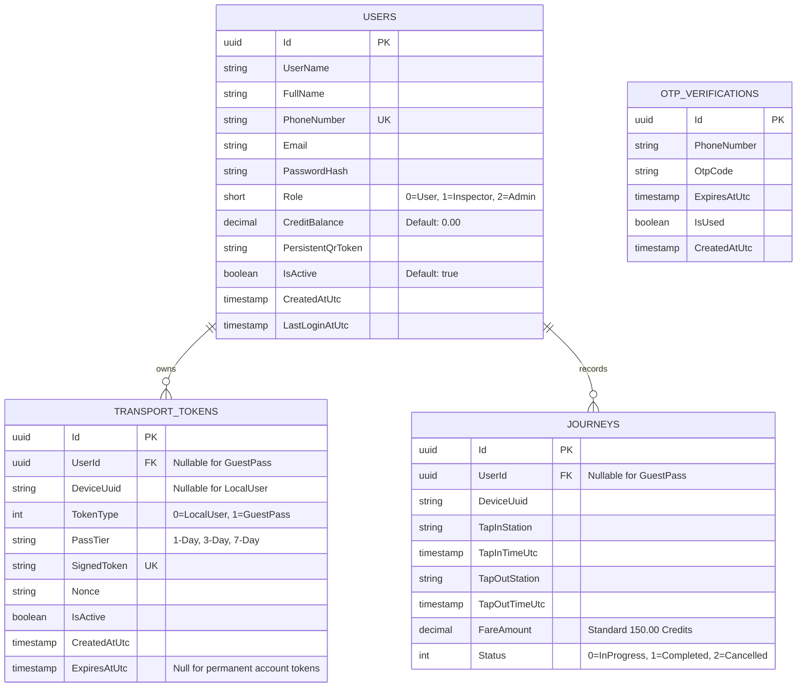
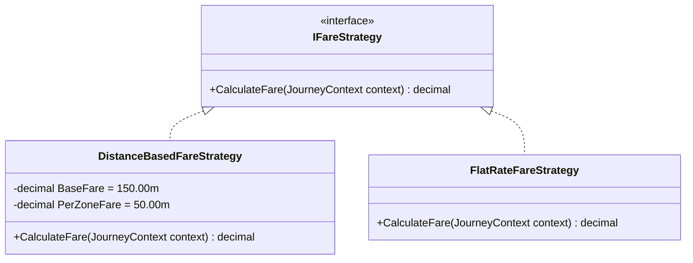

# Backend Architectural Blueprint & Design Decisions – Ticketing System

## 1. Executive Summary & Tech Stack

This document defines the server-side architecture, domain models, cryptographic protocols, API contracts, and security rules powering the **UrbanTransit** Metropolitan Transport Ticketing System.

### Technology Stack
- **Framework:** ASP.NET Core 10 Web API
- **Language:** C# 12 / .NET 10
- **Data Persistence:** Entity Framework Core with PostgreSQL provider (`Npgsql.EntityFrameworkCore.PostgreSQL`)
- **Container Infrastructure:** Docker Compose (`postgres:16-alpine`, port 5432)
- **Authentication & Security:** JWT Bearer tokens with Role claims (`UserRole.User`, `UserRole.Inspector`, `UserRole.Admin`), HMAC-SHA256 signature verification, and constant-time string equality validation (`CryptographicOperations.FixedTimeEquals`).

---

## 2. Domain Entities & Database Schema

The relational schema is configured in `AppDbContext.cs` and deployed to PostgreSQL:



---

## 3. Cryptographic Token Protocol (HMAC-SHA256)

To protect the transit network against ticket counterfeiting and replay attacks without requiring online round-trips for every gate clearance, the system issues cryptographically signed tokens.

### 3.1 Token Format
```text
TK1|{type}|{identifier}|{expiryEpoch}|{nonce}|{signature}
```

- **`TK1`:** Token protocol specification version identifier.
- **`type`:** `LOCAL` (account-bound commuter) or `GUEST` (device-bound visitor).
- **`identifier`:** User GUID (for commuters) or RFC4122 Device UUID (for visitors).
- **`expiryEpoch`:** Unix timestamp in seconds (0 for permanent commuter tokens; positive timestamp for guest passes).
- **`nonce`:** Cryptographically random 8-character hex string preventing replay attacks.
- **`signature`:** URL-safe Base64 HMAC-SHA256 digest computed over `TK1:{type}:{identifier}:{expiryEpoch}:{nonce}` using the authority's secret signing key.

### 3.2 Gate Tap Clearance Pipeline
When a turnstile scanner receives a token payload:
1. **Format Check:** Validates delimiter split (`|`), 6 segments, and `TK1` prefix.
2. **Signature Re-computation:** Generates the expected HMAC-SHA256 hash using the master server signing key.
3. **Timing Attack Protection:** Compares signatures using `CryptographicOperations.FixedTimeEquals`.
4. **Expiration Verification:** For `GUEST` passes, verifies `DateTimeOffset.UtcNow <= ExpiryTime`.
5. **Account Clearance (Commuters):** Checks `user.IsActive == true` and verifies `user.CreditBalance >= 150.00` credits before gate unlatching.

---

## 4. Strategy-Based Dynamic Fare Engine (`IFareStrategy`)

The fare engine uses the **Strategy Pattern** to separate commuter distance-based deductions from visitor flat-rate passes:



- **`DistanceBasedFareStrategy.cs`:**
  - Evaluates entry and exit stations.
  - Base metro fare: `150.00 Credits` (~$2.50 USD).
  - Zone boundary crossings incur `50.00 Credits` per zone boundary traversed.
- **`FlatRateFareStrategy.cs`:**
  - Returns `0.00 Credits` for active guest passes. The fee was collected during pass checkout.

---

## 5. REST API Controller Catalog

### 5.1 Authentication (`AuthController.cs`)
- `POST /api/auth/request-otp`
  - Input: `{ "phoneNumber": "+94771234567" }`
  - Behavior: Dispatches 6-digit verification code with 2-minute validity. In development mode, the OTP is returned in the response payload for testing.
- `POST /api/auth/verify-otp`
  - Input: `{ "phoneNumber": "+94771234567", "otpCode": "123456", "fullName": "Jane Doe" }`
  - Output: JWT bearer token, user profile, and current wallet balance.
- `POST /api/auth/admin-login`
  - Input: `{ "username": "admin", "password": "Admin@123" }`
  - Output: JWT bearer token with `Role: Admin` (`2`).

### 5.2 Commuter Account (`AccountController.cs` – Requires JWT Bearer)
- `GET /api/account/profile`
  - Returns user profile, current credit balance, account activation status, and persistent QR token.
- `POST /api/account/topup`
  - Input: `{ "amount": 1000.00, "paymentReference": "REF-CARD-XXXX" }`
  - Behavior: Atomically credits wallet and returns updated balance.
- `GET /api/account/history`
  - Returns chronological journey history and credit reload receipts.

### 5.3 Token & Guest Pass Engine (`TokenController.cs`)
- `GET /api/token/generate`
  - Dual-mode endpoint: returns signed token for authenticated commuters or creates/returns active guest pass for `?deviceUuid=...`.
- `POST /api/token/guest-pass`
  - Input: `{ "deviceUuid": "...", "passTier": "1-Day", "amount": 350.00 }`
  - Issues time-bound guest pass (`1-Day` = 24h, `3-Day` = 72h, `7-Day` = 168h).
- `GET /api/token/guest-pass/{deviceUuid}`
  - Fetches currently active pass for client device.
- `POST /api/token/validate`
  - Input: Plaintext QR payload string.
  - Output: Validation result, user type, identifier, and clearance decision.

### 5.4 Transit Operations Administration (`AdminController.cs` – Requires Role: Admin)
- `GET /api/admin/stats`
  - Returns network telematics: `TotalUsers`, `TotalWalletCredits`, `ActiveGuestPasses`, `TotalJourneys`, `TotalFareCollected`.
- `GET /api/admin/users`
  - Filterable commuter audit list with query params `?search=...&role=...&isActive=...`.
- `PUT /api/admin/users/{id}/status`
  - Input: `{ "isActive": false }`
  - Toggles commuter account suspension.
- `POST /api/admin/users/{id}/balance`
  - Input: `{ "amount": 500.00, "reason": "Customer Service Goodwill Credit" }`
  - Adjusts wallet balance with audit logging.
- `GET /api/admin/journeys`
  - Returns real-time stream of network turnstile tap events.
- `GET /api/admin/guest-passes`
  - Returns fleet list of issued and active visitor passes.

---

## 6. Hardware Scanning Isolation Policy

Physical optical turnstiles and validation scanners are station infrastructure:
- The passenger-facing web application never runs turnstile clearance operations.
- Turnstile tap testing is conducted exclusively via `POST /api/token/validate` triggered through the Admin Operations Console (`GateScannerModal.tsx`).

---

## 7. Data Seeding & Development Environment

On application startup, `DbInitializer.cs` verifies database connectivity and seeds:
1. **Default Administrator Account:**
   - Username: `admin`
   - Email: `admin@urbantransit.metro`
   - Password: `Admin@123`
   - Role: `UserRole.Admin` (`2`)
2. **Standard Stations & Transit Fleet Mock Data.**
